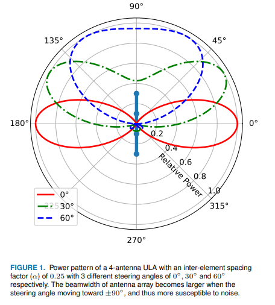
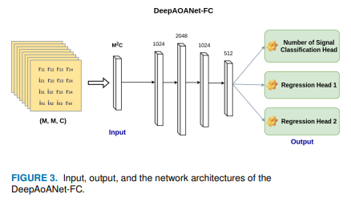
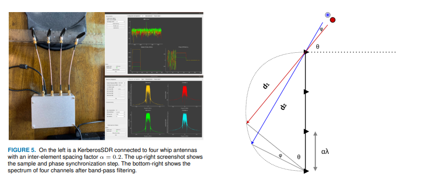
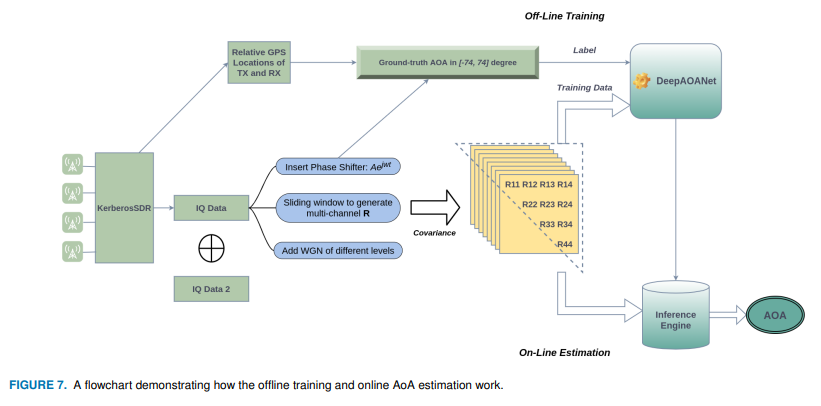
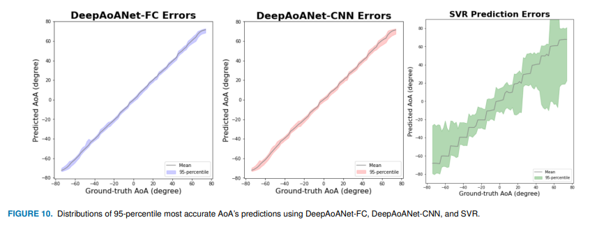
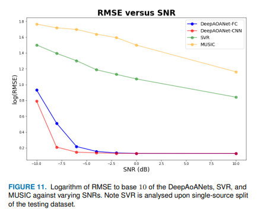
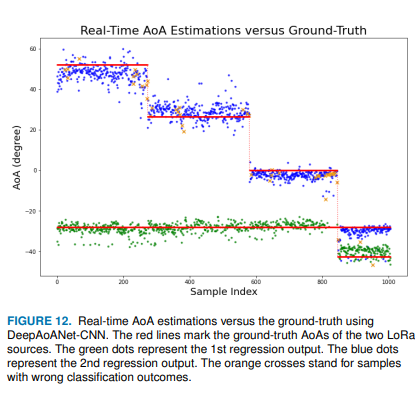

# DOA Estimation with Four Antennas and One SDR, Neural Network to Reduce Direction of Arrival Error Within 2 Degrees

Four antennas, one SDR, a neural network to reduce direction finding errors within 2 degrees using software radio hardware costing hundreds of dollars, and adding a deep neural network can achieve real-time direction finding in multipath and low signal-to-noise ratio environments—this is DeepAoANet, which has its real-time dataset publicly available.
DeepAoANet real-time direction finding interface
I. Old problem, new pain point: Why MUSIC fails in practice
Measurement and positioning based on radio frequency signals are indispensable foundational capabilities in radar, communication, and unmanned systems. However, the real challenge arises when moving these algorithms outdoors or indoors: multipath propagation.
A signal reflected off walls and ground will be received by both the direct path and several delayed copies at the receiver end, each of them being close in angle and either dominating or subduing the other in energy. Represented by MUSIC, subspace-based algorithms perform poorly under such scenarios: on one hand, the covariance matrix estimation requires sufficient number of fast shots; when the fast shots are insufficient, noise subspace leakage occurs, leading to spectral peak position drift; on the other hand, under weak signal conditions (like long-distance LoRa terminals), the angle resolution of MUSIC significantly drops, even giving false spectral peaks.
Traditional approaches involve adding array elements, speeding up the shots, and increasing computational load, with the costs rising accordingly. The research team from Aston University in the UK changed their approach: since the digital sampling frontend can easily obtain multichannel baseband data, could it not allow a neural network to directly "read" the angles from a single fast shot covariance matrix?
This is the starting point for DeepAoANet.
II. Method Design: From Signal to Angle, A Single Pipeline Runs Through
The processing flow can be summarized into three steps:
Step 1: Construct the Covariance Tensor. At the receiving end, each time a segment of IQ baseband samples is captured, it is divided into 8 sub-windows. Within each sub-window, an 8x8 array covariance matrix is estimated, with the real and imaginary parts separated and stacked to form a 4x4x8 tensor. This tensor serves as the input to the network—note that single-shot tensors are directly fed into the network without reliance on long-term accumulation of multiple shots.
Step two: Multi-task neural networks. The research team designed a "one-to-three" multi-task architecture: after sharing the main trunk, three output heads are split out.
A signal number classification head, to determine whether the current is 0, 1 or 2 incoming signals;
Two angle regression heads, respectively output the arrival angle (AoA) in single signal and dual signal scenarios, with an angle range of -74° to 74°.
The loss function is composed of classification and regression losses, weighted together for end-to-end joint training. In addition to this fully connected version (DeepAoANet-FC), the team also provides a convolutional version (DeepAoANet-CNN), treating the covariance tensor as "images" for processing, which results in a smaller parameter count and lighter deployment.
Step three: Physically driven data augmentation. Real measured data is always insufficient. The team's method is clever: Applying deterministic phase rotation to the already-enrolled baseband samples at a specified angle difference, effectively "shifting" the direction of arriving waves, and then superimposing different levels of noise. This results in multiple training samples with multiple angles and noise levels from a single real measurement—without altering the physical channel structure, the dataset size is scaled up by an order of magnitude.
III. Experiment: Three environmental tests, four methods competing on the same stage.
The data collection covers a variety of line-of-sight (LOS) and non-line-of-sight (NLOS) scenarios, including corridor environments and open LOS links. The emission angles range from -70° to 70° with every 10° interval, and all the collected data and labeled angles have been publicly released.
The benchmarks chosen are restrained yet very pertinent to the issue at hand:
MUSIC: Classical subspace algorithm, requires spectrum search;
SVR: Traditional machine learning regression baseline;
DeepAoANet-FC / CNN: This method.
Comparative Error CDF of Different Methods
The results are clear at a glance: In terms of error cumulative distribution (CDF), both versions of DeepAoANet comprehensively lead MUSIC and SVR. A few key figures deserve to be highlighted separately:
Signal number determination accuracy exceeds 99%. The network not only reports the angle but also clearly states "How many signals have entered now" — this is often more difficult in real systems than just reporting the angle itself, as false alarms and missed alarms directly determine whether the back-end positioning logic is triggered.
Average absolute angle error is less than 2°, achieving sub-degree level regression accuracy. Moreover, the error distribution is stable within a wide field of view from -74° to 74°, without edge angle degradation.
Error Scatter Distribution
Resilient under negative signal-to-noise ratio. Thanks to noise enhancement training, the model maintains stable outputs even below the original dataset's signal-to-noise ratio (SNR below -4 dB) for MUSIC, which has failed extensively in this range.
Performance under Different Signal-to-Noise Ratios
Real-time assurance. The inference engine has been tested on multiple platforms with real-time output of polarization power spectrum through a visualization interface, with single inference taking milliseconds—for small-scale networks of quaternion arrays, computational overhead is not a bottleneck.
Several Remarkable Implications Worth Considering
Beyond paper metrics, this work offers several insights for readers working in radar communication:
Firstly, the covariance tensor is a good input representation. It naturally does not sensitive to signal amplitude (normalized), retains phase structure between elements, and introduces temporal information through multi-window slices, much more stable than using raw baseband samples directly.
Secondly, the joint modeling of classification and regression solves the problem of "first determining numbers, then measuring angles." In traditional processes, signal number estimation and angle estimation are two independent modules, with errors cascading; multi-task networks allow them to share features and mutually constrain each other.
Thirdly, phase rotation-based data augmentation is nearly cost-free. As long as the array manifold is known, applying deterministic phase rotation to baseband samples can synthesize training samples at any angle, a technique worth repurposing in array signal data augmentation.
It should be noted that the original model was trained on LoRa signals. When switching to other waveforms (such as radar pulses or communication frames), the author recommends fine-tuning with local signals before going live—this is also a standard practice in data-driven methods.
Low-cost, low-entry SDR hardware, single quick capture for angle output, robust output under negative signal-to-noise ratio—when the cost of direction finding drops to just a few hundred yuan, what would you do with it? Feel free to discuss your application scenarios in the comments section.

## Images

<!-- PAYMENT_BLOCK -->

## Get this dataset

- Payment link (Stripe): [Buy now](https://buy.stripe.com/3cs8yP7sY87d0vu9AB)
- Payment QR code: 

<!-- /PAYMENT_BLOCK -->
